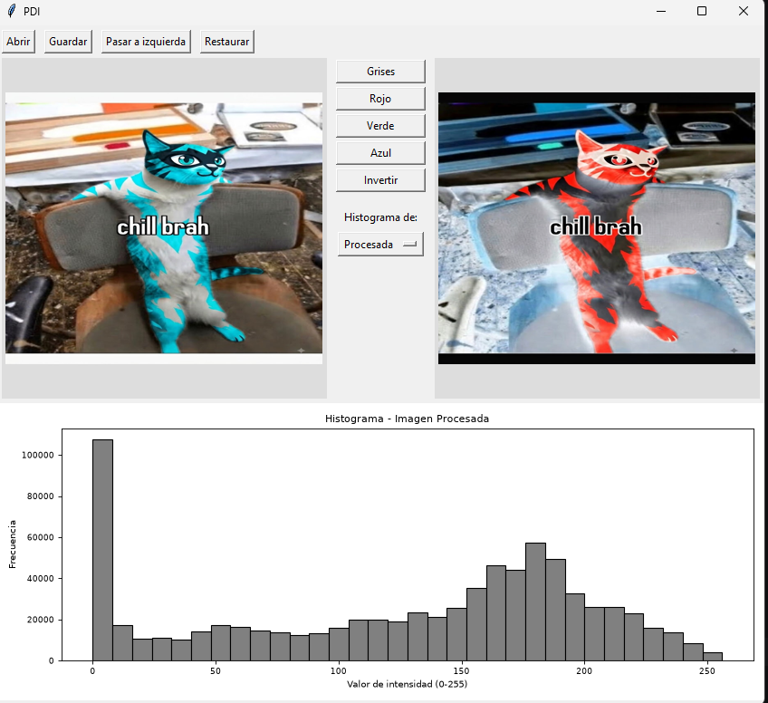

# Procesamiento Digital de Imágenes (PDI)
Interfaz gráfica para procesamiento de imágenes y visualización de histogramas.

### Integrantes
- Alex Gabriel Calatayud
- Santiago Balceda
- Robinson Elias Cala

**Ejecución:** `python main.py`
